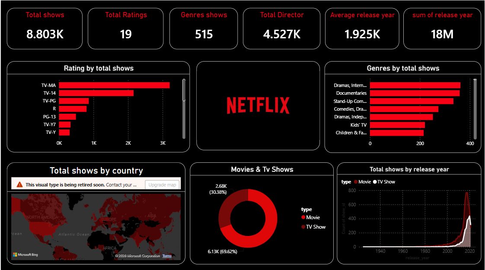

# Netflix Data Analytics Dashboard

## Project Overview

An interactive Netflix Data Analytics Dashboard created using Power BI to analyze streaming content and catalog trends.

## Tools Used

- Power BI
- Excel / CSV
- Data Analysis
- Data Visualization

## Key Analysis

- Total Shows
- Total Ratings
- Genres Shows
- Total Directors
- Average Release Year
- Sum of Release Year
- Rating by Total Shows
- Genres by Total Shows
- Total Shows by Country
- Movies & TV Shows
- Total Shows by Release Year

## Key Insights

- The catalog has **8.8K shows**, with **19 rating categories**, **515 genre combinations** and **4.5K directors**
- **Movies make up 69.62% (6.13K)** of the catalog and **TV Shows 30.38% (2.68K)**
- **TV-MA** is the most common rating (about 3K+ titles), followed by **TV-14** and **TV-PG**
- Top genres are **Dramas, Documentaries and Stand-Up Comedy**
- Content releases rose sharply after the 2000s and **peaked around 2017-2018**
- The map shows content spread across North America, Europe and Asia

## Dataset

Netflix titles data (show type, director, country, rating, genre and release year).

## Dashboard

Created an interactive Power BI dashboard to generate streaming insights from Netflix data.

## Skills

Power BI | Data Analysis | Data Visualization | Dashboard Development

## Dashboard Preview

